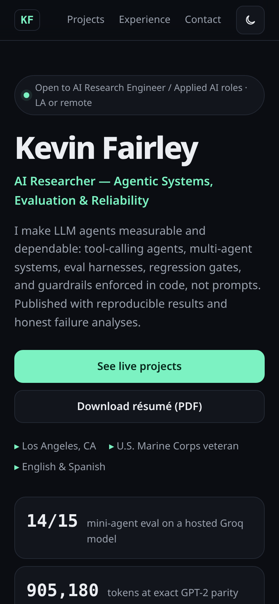

# kfairley9999.github.io

Personal portfolio of **Kevin Fairley**, AI Researcher (Agentic Systems, Evaluation & Reliability).

**Live:** https://kfairley9999.github.io

<p>
  
  
</p>

## What's on it

- **Featured work:** catchpr and LeadFlow MCP (Provefirst projects: a proof-gated PR reviewer and an MCP lead-pipeline server, both with live demos), ForgePulse (durable PR triage, CI routing records, and portable policy, with a live playground), mcp-doctor, ai-sdk-resilience, agent-crew, llm-watch, mcp-sync, mini-agent, Personal Knowledge Engine (RAG), hermes-phone-agent, fast-tokenizer, and the U.S. Economic Indicators Dashboard. Each card links to the code and, where one exists, a live demo.
- **More shipped apps:** Turf Preview, Light Preview, Pulse CRM, EquiFlow.
- About, skills, experience and education, a downloadable résumé ([PDF](assets/Kevin_Fairley_Resume.pdf)), and contact links.

Every fact on the page comes from my résumé or my GitHub repositories.

## How it's built

- Plain HTML, CSS, and a few lines of JavaScript. No framework, no build step, no trackers, no third-party requests.
- **Design:** a warm, editorial look. Cream and off-white surfaces, terracotta and amber accents, deep warm-charcoal text, and a warm brown dark mode (follows the system setting, with a remembered toggle).
- **Type:** Fraunces (headings) and Inter (body), self-hosted as variable WOFF2 with `font-display: swap`, preloaded, with metric-adjusted fallbacks to avoid layout shift.
- **Motion:** gentle hero entrance, fade-in on scroll, and hover lift on cards and buttons. All of it is disabled under `prefers-reduced-motion`, and content stays visible without JavaScript.
- Mobile-first, checked at 390 px (no horizontal scroll) and at desktop widths. Text colours meet WCAG AA contrast in both themes.
- Accessibility: semantic landmarks, a skip link, visible focus rings, 42–48 px touch targets, and descriptive link text for screen readers.
- Hosted free on GitHub Pages from the `main` branch root (`.nojekyll` disables Jekyll processing).

## Files

| Path | Purpose |
| --- | --- |
| `index.html` | All page content |
| `styles.css` | Theme tokens (light and dark) and layout |
| `script.js` | Theme toggle and footer year |
| `assets/Kevin_Fairley_Resume.pdf` | Résumé download |
| `assets/kevin-fairley.webp` / `.jpg` | Profile photo, 600×600 (WebP with JPG fallback; JPG is also the link-preview image) |
| `assets/kevin-fairley-128.webp` / `.jpg` | Small photo for the nav bar |
| `assets/fonts/` | Fraunces and Inter (SIL Open Font License 1.1), Latin subset |
| `assets/us-economic-dashboard.webp` / `.jpg` | Product shot for the dashboard card |
| `assets/catchpr.webp` / `.jpg` | Replay playground shot for the catchpr card |
| `assets/leadflow-mcp.webp` / `.jpg` | Live MCP session shot for the LeadFlow card |
| `assets/forgepulse.webp` / `.jpg` | Playground shot for the ForgePulse 0.2.0 card |
| `assets/favicon.svg` | Favicon |

## Run locally

```bash
python3 -m http.server 8000
# open http://localhost:8000
```

## Update

Edit `index.html`, commit, and push to `main`. GitHub Pages redeploys in about a minute.

## Contact

[LinkedIn](https://www.linkedin.com/in/kevin-fairley-94330b42a/) · [GitHub](https://github.com/kfairley9999) · kfairley9999@gmail.com
