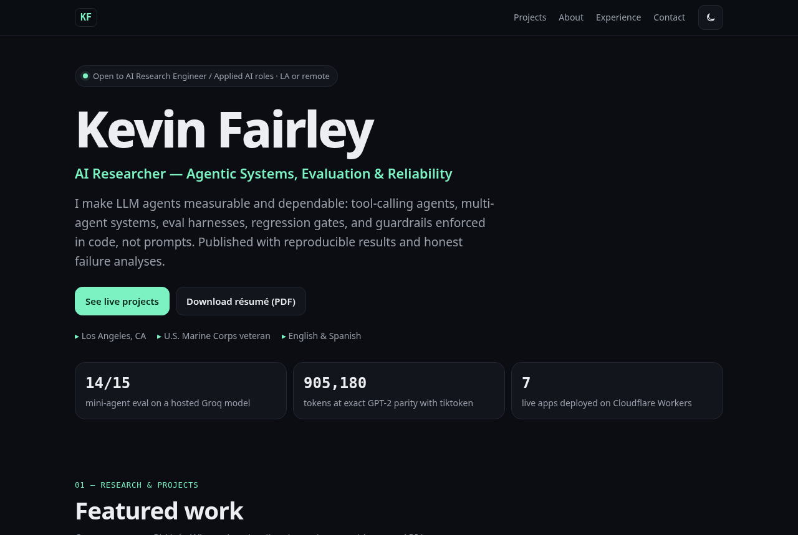

# kfairy9999.github.io

Personal portfolio of **Kevin Fairley**, AI Researcher (Agentic Systems, Evaluation & Reliability).

**Live:** https://kfairy9999.github.io

<p>
  
  
</p>

## What's on it

- **Featured work:** agent-crew (multi-agent research desk), llm-watch (LLM call ledger and eval regression gate), mini-agent (tool-calling agent with self-check and eval harness), Personal Knowledge Engine (RAG), hermes-phone-agent (code-enforced guardrails), fast-tokenizer (Rust BPE tokenizer). Each card links to the code and, where one exists, a live demo.
- **More shipped apps:** Turf Preview, Light Preview, Pulse CRM, EquiFlow.
- About, skills, experience and education, a downloadable résumé ([PDF](assets/Kevin_Fairley_Resume.pdf)), and contact links.

Every fact on the page comes from my résumé or my GitHub repositories.

## How it's built

- Plain HTML, CSS, and a few lines of JavaScript. No framework, no build step, no trackers, no external fonts.
- Mobile-first layout, tested at 390 px wide, with no horizontal scroll.
- Follows the system dark/light setting, with a manual toggle that's remembered in `localStorage`.
- Accessibility: semantic landmarks, a skip link, visible focus rings, 40–44 px touch targets, and `prefers-reduced-motion` support.
- Hosted free on GitHub Pages from the `main` branch root (`.nojekyll` disables Jekyll processing).

## Files

| Path | Purpose |
| --- | --- |
| `index.html` | All page content |
| `styles.css` | Theme tokens (light and dark) and layout |
| `script.js` | Theme toggle and footer year |
| `assets/Kevin_Fairley_Resume.pdf` | Résumé download |
| `assets/kevin-fairley.webp` / `.jpg` | Profile photo, 600×600 (WebP with JPG fallback; JPG is also the link-preview image) |
| `assets/kevin-fairley-128.webp` / `.jpg` | Small photo for the nav bar |
| `assets/favicon.svg` | Favicon |

## Run locally

```bash
python3 -m http.server 8000
# open http://localhost:8000
```

## Update

Edit `index.html`, commit, and push to `main`. GitHub Pages redeploys in about a minute.

## Contact

[LinkedIn](https://www.linkedin.com/in/kevin-fairley-94330b42a/) · [GitHub](https://github.com/kfairy9999) · kfairley9999@gmail.com
